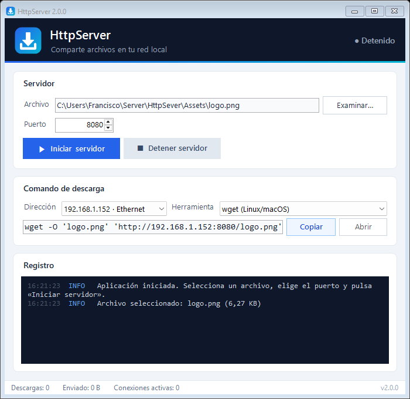

<p align="center">
  
</p>

<h1 align="center">HttpServer</h1>

[](https://github.com/FranciscoFdez05/HttpSever/actions/workflows/build.yml)
[](https://github.com/FranciscoFdez05/HttpSever/releases)
[](https://dotnet.microsoft.com/download/dotnet/10.0)
[](LICENSE.txt)

HttpServer comparte un archivo con otros equipos de tu red local en un par de clics: eliges el archivo, pulsas «Iniciar servidor» y copias el comando de descarga (`wget`, `curl`, PowerShell…) o abres la URL en cualquier navegador. Es una aplicación de escritorio para Windows, sin instalación ni configuración.

<p align="center">
  
</p>

## ✨ Características

- 📂 **Selección de archivo** con diálogo o arrastrando el archivo a la ventana.
- 🚪 **Puerto configurable**, con aviso claro si está ocupado o reservado por Windows.
- 🌐 **Elección de la IP** de este equipo (Ethernet, Wi-Fi, VPN…), con las direcciones de red local primero.
- 📋 **Comando de descarga listo para copiar** en varios formatos: `wget`, `curl`, PowerShell, `certutil` o solo la URL.
- ⏯️ **Descargas reanudables** (`Range` / `206 Partial Content`): `wget -c` y `curl -C -` continúan donde se cortaron.
- 🖥️ **Página web de descarga** al abrir `http://IP:puerto/` desde cualquier navegador (también en el móvil).
- 📜 **Registro en tiempo real** con hora, nivel, peticiones, velocidad de transferencia y descargas interrumpidas; se puede copiar o guardar.
- 📊 **Barra de estado** con descargas completadas, datos enviados y conexiones activas.
- 💾 **Recuerda tus preferencias** (puerto, IP, herramienta y última carpeta).

## 🖥️ Requisitos

- Windows 10 u 11.
- [.NET Desktop Runtime 10](https://dotnet.microsoft.com/download/dotnet/10.0) para ejecutar, o el SDK de .NET 10 para compilar.

## ⚙️ Instalación

Descarga el ejecutable desde [Releases](https://github.com/FranciscoFdez05/HttpSever/releases) o compílalo tú mismo:

```bash
git clone https://github.com/FranciscoFdez05/HttpSever.git
cd HttpSever
dotnet run -c Release
```

Para generar un único `HttpServer.exe` (requiere el runtime de .NET instalado):

```bash
dotnet publish HttpSever.csproj -c Release -o publish
```

## 📋 Uso

1. Pulsa **Examinar…** (o arrastra un archivo a la ventana) para elegir qué compartir.
2. Elige el **puerto** (por defecto `8080`).
3. Pulsa **▶ Iniciar servidor**.
4. Elige la **dirección** y la **herramienta** del equipo que va a descargar, y pulsa **Copiar**.
5. Pega el comando en el otro equipo. También puedes abrir `http://IP:puerto/` en un navegador; **Abrir** te la muestra en el tuyo.
6. Pulsa **■ Detener servidor** cuando termines. Las descargas en curso se cancelan.

Ejemplos de comandos generados:

```bash
wget -O 'informe.pdf' 'http://192.168.1.20:8080/informe.pdf'
curl -fL -o 'informe.pdf' 'http://192.168.1.20:8080/informe.pdf'
```

```powershell
Invoke-WebRequest -Uri 'http://192.168.1.20:8080/informe.pdf' -OutFile 'informe.pdf'
```

> [!NOTE]
> La primera vez que inicies el servidor, Windows puede preguntar si permites el acceso a la red. Acepta en **redes privadas** para que otros equipos puedan conectarse.

> [!WARNING]
> El servidor no tiene autenticación ni cifrado: cualquier equipo de la red que conozca la URL puede descargar el archivo mientras esté activo. Úsalo solo en redes de confianza y detenlo al terminar.

## 🗂️ Estructura del proyecto

```
HttpSever/
├── Program.cs                 Punto de entrada y gestión global de errores
├── Core/                      Lógica independiente de la interfaz
│   ├── ServidorArchivos.cs    Servidor HTTP/1.1 (GET, HEAD, Range, ETag…)
│   ├── SolicitudHttp.cs       Lectura y validación de peticiones
│   ├── PaginaIndice.cs        Página web de descarga
│   ├── GeneradorComandos.cs   Comandos wget, curl, PowerShell, certutil
│   ├── UtilidadesRed.cs       Detección de IPs locales y formato de tamaños
│   ├── TiposMime.cs           Tipos de contenido por extensión
│   ├── Configuracion.cs       Preferencias en %AppData%\HttpServer
│   └── RegistroEventArgs.cs   Eventos de registro
├── UI/
│   ├── MainForm.cs            Ventana principal
│   ├── MainForm.Designer.cs
│   └── Recursos.cs            Carga del logo incrustado
├── Assets/                    Logo (SVG fuente, PNG e ICO)
└── tools/GenerarLogo.ps1      Regenera logo.png y logo.ico
```

El servidor (`Core/ServidorArchivos`) no depende de WinForms: informa mediante el evento `Registro` y expone estadísticas que la interfaz consulta.

## 🤝 Contribuir

Las contribuciones son bienvenidas:

1. Haz un fork del repositorio.
2. Crea una rama (`git checkout -b feature/nueva-feature`).
3. Haz commit de tus cambios (`git commit -m 'Añadir nueva feature'`).
4. Sube la rama (`git push origin feature/nueva-feature`).
5. Abre un Pull Request.

## 📄 Licencia

Distribuido bajo la licencia incluida en [LICENSE.txt](LICENSE.txt).

---

**Developed with ❤️ by [Francisco](https://github.com/FranciscoFdez05)**
